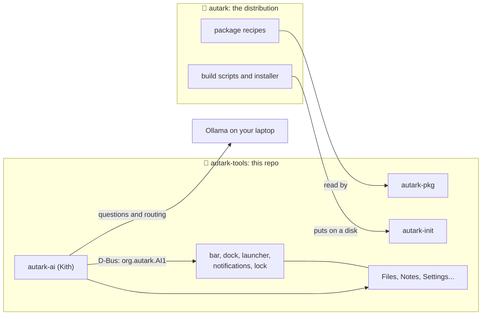

<h1 align="center">autark-tools</h1>

<p align="center">
  The Rust programs behind <a href="https://github.com/Seuketchi/autark">Autark</a>:<br>
  a desktop shell, a local-first AI assistant, a package manager and an initramfs unlocker.
</p>

<p align="center">
  <a href="LICENSE-MIT"></a>
  
  
  <a href="https://github.com/Seuketchi/autark-tools/stargazers"></a>
  <a href="https://github.com/Seuketchi/autark-tools/commits/main"></a>
</p>

They live apart from the distro so other Linux systems can use them too.

## ✨ Highlights

| | |
| --- | --- |
| 🖥️ **Desktop shell** | A top bar, a dock with magnification, a Spotlight-style launcher with clipboard history, a notification centre with widgets, a lock screen (password or fingerprint), a wallpaper layer, night light and display layouts. GTK4 and Rust, for any wlroots compositor. |
| 🗂️ **Apps** | Files, Notes (Markdown vaults with links and a graph), Calendar, Contacts, Mail pieces, Viewer, Player, Calculator, Archives, Clock, Task manager, Screenshots, Settings and a hardware page. |
| 🤖 **Kith** | An assistant that runs on [Ollama](https://ollama.com) on your laptop. Off until you turn it on; it reads only files you name and logs every call. Jev, an optional cloud engine for fast typed decisions, is off unless you switch it on per feature. |
| 📦 **autark-pkg** | Builds package recipes into signed archives, installs, upgrades, removes and rolls back, and imports a recipe from Arch Linux when none exists. Autark only. |
| 🔓 **autark-init** | An initramfs init that unlocks a LUKS2 disk with TPM plus PIN, then hands over to systemd. |
| 🧱 **autark-sandbox** | Runs a vendor binary under a per-app Landlock profile. |

## 🧩 How it fits with Autark



The distribution builds the system and installs it; these programs are what you see and use once it runs. The tools talk to each other over D-Bus (`org.autark.*`) and read plain config files under `~/.config/autark/`, so a change in Settings is just an edit to a file the tools already watch.

## 📦 Crates

| Crate | What it is |
| --- | --- |
| `autark-common` | Shared code: config loading, D-Bus helpers and Linen theme tokens |
| `autark-bar` | Top bar: app menu, clock, Wi-Fi, battery, volume, notification centre button |
| `autark-dock` | Dock with magnification and running-app indicators |
| `autark-launcher` | Spotlight-style launcher, clipboard history (Super+V) and Kith's entry point |
| `autark-notifyd` | Notification centre and `org.freedesktop.Notifications` service, with widgets |
| `autark-lock` | Lock screen using `ext-session-lock` and PAM |
| `autark-accounts` | Accounts: Google, iCloud, Fastmail and other mail, calendar and contact accounts signed in once (`org.autark.Accounts1`); passwords and OAuth refresh tokens live in the keyring, and only Autark's own apps are handed credentials, never Kith |
| `autark-pim` | Mail, calendars, tasks and contacts over open protocols: iCalendar, vCard, CalDAV, CardDAV, IMAP and SMTP, for the Calendar, Tasks, Contacts and Mail apps |
| `autark-calendar` | Calendar: a month grid and day agenda over every account's CalDAV calendars, with an event editor; serves `org.autark.Calendar1` (agenda, create, delete) for Kith while it runs |
| `autark-contacts` | Contacts: people from every account's CardDAV address books, searchable and grouped by letter, with an editor; serves `org.autark.Contacts1` (search, create, delete) for Kith and Mail's address completion while it runs |
| `autark-ai` | Kith's local daemon (`org.autark.AI1`): routing, Jev and Ollama, laptop MCP tools, tasks, memory |
| `autark-agentd` | The team's backend (`org.autark.Agents1`): Kith's agents with their jobs, souls, conversations and memories, and an event log; it asks `autark-ai` for the model and for what an agent may read. See [docs/agentd.md](docs/agentd.md) |
| `autark-kith` | Kith's team: a roster of named agents on the left, a conversation with the one you pick on the right. Each has a job, a soul, a conversation and a small memory of its own and a list of what it may read; a new install starts with ATLAS, PIPER, RAVEN and QUILL, and an agent for each profession skill (accountant, tax, lawyer, doctor, psychiatrist, engineer) found on the machine. Serves nothing: it talks to `autark-agentd` |
| `autark-stats` | System metrics service over D-Bus; polls only while something displays the numbers |
| `autark-wallpaper` | The desktop background: one of four drawn wallpapers or a picture, on every display |
| `autark-monitor` | Task manager: apps and processes with CPU, memory, disk, network and energy impact; force quit |
| `autark-viewer` | Viewer: pictures with zoom toward the pointer, pan, rotate, and the rest of the folder one key away |
| `autark-player` | Player: video and audio through GStreamer, frames drawn by GTK, with controls that fade while a video plays |
| `autark-hub` | Software: find, install, update, remove and roll back packages from a window; `autark-pkg` does the work, through a root helper that only knows those four verbs |
| `autark-calc` | Calculator: type a sum or press keys, with the answer shown as you go |
| `autark-archive` | Archives: look inside a zip or tar, take things out, pack files up through `bsdtar`; extraction never overwrites anything |
| `autark-keys` | Keyboard shortcuts: every key combination Wayfire answers, read from its own config so it is never out of date |
| `autark-clock` | Clock: alarms, a timer and a stopwatch; alarms and timers ring through systemd user timers, with the window closed |
| `autark-hw` | Hardware: every device and its driver, what's missing and why, and the laptop's controls; `autark-hw devices`, `doctor` and `controls` work without the window |
| `autark-hw-helper` | Root helper for `autark-hw`, started by D-Bus on demand: loads a driver for hardware that's here and sets a power profile or charge limit, from a short allowlist, after polkit agrees (see `hardware/README.md`) |
| `autark-notes` | Notes: Apple Notes surface over plain Markdown vaults, with links, backlinks and graph view |
| `autark-files` | Files app, sharing file code with Notes |
| `autark-shot` | Screenshots (Shift+Super+3/4/5); screen recording later |
| `autark-nightlight` | Night light: sunset to sunrise through Wayland gamma control |
| `autark-displays` | Displays: layouts remembered per set of monitors, clamshell mode |
| `autark-settings` | Settings: one pane per area, editing the same config files the tools watch |
| `autark-sandbox` | Sandbox launcher: runs vendor binaries under a per-app Landlock profile |
| `autark-init` | Initramfs init: TPM-plus-PIN LUKS2 unlock through libcryptsetup and tpm2-tss, then hands over to systemd |
| `autark-pkg` | Autark's package manager (Autark-only): signed packages from recipes, with install, remove, upgrade, search and rollback |
| `autark-power` | Idle timers (screens off, then sleep; battery or plugged in) and the low-battery warning |

Each tool is described in detail in [`docs/reference.md`](docs/reference.md): what it does, its D-Bus interface and its settings.

## 🐧 Where it runs

- **Desktop crates:** any wlroots compositor (Wayfire, sway, Hyprland, labwc, river) with systemd and D-Bus. GNOME and KDE aren't targeted.
- **`autark-init`:** any systemd distro with LUKS2 and a TPM.
- **`autark-pkg` and `autark-hub`:** Autark only (the Hub is a window on `autark-pkg`).
- **Configuration:** paths and settings come from config files, never hard-coded to Autark.

## 🚀 Install and build

On Autark the tools are part of the system. On another Linux there are no prebuilt binaries yet, so build them from source:

The workspace builds with a current stable Rust and crates.io (`cargo build --release`; `cargo check` while developing). On Autark the system libraries are already there; on Debian or Ubuntu the shell crates can be built and tested too:

```
sudo apt install libgtk-4-dev libgtk4-layer-shell-dev libgtk4-session-lock-dev libpam0g-dev libpipewire-0.3-dev libclang-dev wayfire grim
cargo check
```

Run Wayfire in a nested window, then start a crate inside it with `cargo run -p autark-bar`. Without a window, `WLR_BACKENDS=headless wayfire` runs it off-screen and `grim` takes a screenshot.

To build without the network, run `cargo vendor` once on a connected machine and point cargo at the folder it prints (`[source.crates-io] replace-with = "vendored"` in your own `~/.cargo/config.toml`). The repository doesn't carry a cargo config of its own.

## ⚙️ Configuration

Each tool reads `~/.config/autark/<tool>.toml`, then `/etc/autark/<tool>.toml`; every field is optional. For the bar:

```toml
# ~/.config/autark/bar.toml
clock_format = "%a %-d %b  %H:%M"   # chrono strftime; add %S for seconds
battery_percent = true
```

For the dock:

```toml
# ~/.config/autark/dock.toml
size = 52        # 32 to 80
magnify = true
dots = true      # under (or beside) running apps
position = "bottom"   # "bottom", "left" or "right"
autohide = false # hidden until the pointer reaches its edge
pinned = ["org.autark.Files", "firefox", "foot", "galley", "org.autark.Settings"]
```

The dock, like the other tools, watches its file: a change applies as soon as it's saved.

And for notifications:

```toml
# ~/.config/autark/notifyd.toml
banner_seconds = 5   # when the app doesn't say
max_banners = 3
suggestions = true   # Kith's suggestions to quit runaway apps
note = "Plans/Kith.md"   # the Pinned note widget; default: the first note pinned in Notes

# Weather stays off until this is set and switched on in Edit widgets.
[weather]
latitude = 52.52
longitude = 13.41
place = "Berlin"
```

For the lock screen:

```toml
# ~/.config/autark/lock.toml
pam_service = "autark-lock"   # the file in /etc/pam.d
lock_on_sleep = true          # with --daemon
fingerprint = true            # if fprintd has a finger enrolled
```

For Notes:

```toml
# ~/.config/autark/notes.toml
vault = "~/Notes"   # otherwise the last folder opened (Ctrl+Shift+O)
```

For AI:

```toml
# ~/.config/autark/ai.toml
enabled = false   # nothing but Check's rules answers until this is true

[ollama]
url = "http://localhost:11434"
model = ""        # no default: choose after measuring on your laptop
answer_model = "" # writes Kith's answers (a bigger, slower model can pay off here); empty means `model`
timeout_seconds = 120

[features]        # each on once AI is enabled
route = true
rank = true
check = true
ask = true
```

`autark-pkg` reads `/etc/autark/pkg.toml` (paths as the target sees them; `--root` moves them all):

```toml
# /etc/autark/pkg.toml
recipes = "/usr/src/autark/scripts/pkg"
sources = "/var/cache/autark/sources"
cache = "/var/cache/autark/pkgs"      # signed archives
db = "/var/lib/autark/pkg"            # what's installed
build_user = "autark-build"
keep = 2                              # builds kept per package, for rollback
imported = "/var/lib/autark/imported" # recipes imported from Arch Linux, apart from the hand-written ones
arch_importer = "/usr/src/autark/scripts/arch-import.py"
arch_cache = "/var/cache/autark/arch-import"
repo = ""                             # prebuilt packages: a folder served over HTTP(S); empty means build everything
```

**Prebuilt packages.** With `repo` set, `install` and `upgrade` look in the repository for `<name>-<version>-<release>.tar.zst` and its `.minisig` before building. Nothing is trusted because it was downloaded: the signature must verify against a key in the `keys` folder, and the archive must be the package and version asked for (`--no-repo` skips the repository). A system trusts releases by having the release key's `.pub` in `keys`. A repository that can't be reached, or doesn't have the package, means the package is built as before.

The release key is made once, kept offline, and never on the build machine:

```
autark-pkg release-keygen /path/to/usb/release        # asks for a password; writes autark-release.key and .pub
autark-pkg publish out/ --key /path/to/usb/release/autark-release.key [names…]
```

`publish` takes the newest cached build of each package (or of `names`), checks each against the keys it trusts, copies it to `out/`, signs the copy with the release key, and writes `index` (name, version, sha256, size, file) with `index.minisig`. Upload the folder's files to the repository. `--password-file` reads the key's password from a file instead of asking.

A package with no recipe is imported from Arch Linux: `autark-pkg install htop` asks, then runs `scripts/arch-import.py` as the
`autark-build` user, which reads Arch's PKGBUILD, downloads and checks its sources, and writes a recipe (and ones for the runtime
dependencies no recipe has) into `imported`; the build then goes on as for any recipe. `-y` skips the question, `--no-arch` turns
it off, `arch <names>` imports without installing, and `refresh [names]` imports the current Arch recipes again, so `upgrade` sees
new versions. A hand-written recipe wins a name both have, and only `staged` recipes are read from `imported`.

A sandbox profile, `/etc/autark/sandbox/<app>.toml` (root-owned, so an app can't loosen its own):

```toml
description = "Zoom"
exec = "/opt/zoom/zoom"              # its folder is readable automatically
read = ["~/Pictures"]                # read and execute
write = ["~/Downloads", "~/.zoom"]
network = "all"                      # "none" (default), or { connect = [443], bind = [] }
audio = true                         # PipeWire; wayland and gpu default to true, dbus to false
```

Screenshots, `~/.config/autark/shot.toml`:

```toml
folder = "~/Pictures/Screenshots"    # the default
```

Night light, `~/.config/autark/nightlight.toml`:

```toml
schedule = "sun"                     # "sun" (sunset to sunrise), "custom" (from and to) or "off" (by hand only)
latitude = 7.07                      # for "sun"; never leaves the laptop
longitude = 125.61
from = "22:00"                       # used by "custom", and by "sun" until coordinates are set
to = "07:00"
temperature = 4000                   # kelvin at night
fade_minutes = 30
```

## ⭐ Star history

<a href="https://star-history.com/#Seuketchi/autark-tools&Date">
  
</a>

*(The chart is drawn by star-history.com when this page loads.)*

## 📄 License

Licensed under either of [Apache License 2.0](LICENSE-APACHE) or [MIT license](LICENSE-MIT), at your option.

`crates/autark-shot` links two system libraries through C and FFI code: libvpx (BSD 3-Clause, with a patent grant) for VP8 encoding, through `csrc/vpx_shim.c`, and libopus (BSD 3-Clause). They are used as installed on the system, not bundled.
